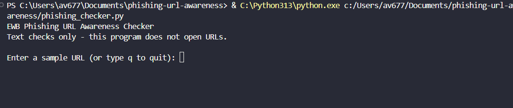
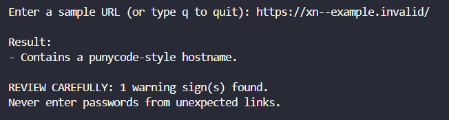

# EWB Phishing URL Awareness Checker

## Overview
Phishing is a trick in which fake links or messages try to persuade people to share passwords, OTPs, or payment details. This educational Python program reads URL text and reports selected warning signs. It never visits a website or sends data anywhere.

## Features
- Detects an `@` symbol in the URL
- Flags URLs longer than 100 characters
- Flags an IP-address hostname
- Flags hostnames with 5 or more dot-separated segments
- Flags punycode-style hostnames containing `xn--`
- Flags the HTTP scheme
- Repeats checks until the user enters `q`, `quit`, or `exit`
- Shows a `REVIEW CAREFULLY` summary when warning signs are found
- Handles malformed URL parsing without crashing

## Requirements
- Python 3.10 or later
- No extra Python packages

## How to Run
Open a terminal in this folder and run:

```bash
python3 phishing_checker.py
```

## Example Output
```text
EWB Phishing URL Awareness Checker
Text checks only - this program does not open URLs.

Enter a sample URL (or type q to quit): http://192.0.2.10/account

Result:
- Uses an IP address instead of a familiar domain.
- Uses HTTP. HTTPS alone does not prove trust.

REVIEW CAREFULLY: 2 warning sign(s) found.
Never enter passwords from unexpected links.
```

## Testing
Run each of the five sample inputs listed in [`tests/test_samples.md`](tests/test_samples.md). Record the actual output from your computer and mark each result PASS or FAIL honestly.

## Screenshots
After you take your real screenshots, save them at these exact paths:
- `screenshots/sample_run.png`
- `screenshots/test_results.png`





## Improvements
1. **Loop with quit:** allows several URLs to be checked without restarting the program.
2. **Review carefully summary:** reports how many warning signs were found.
3. **Malformed-input handling:** returns a clear message for malformed URL formats rather than stopping with a parsing error.

## Limitations
This is an educational tool. It only reads URL text. It does not visit URLs, scan for malware, query reputation services, or prove that a URL is safe. No warning signs found does NOT mean a URL is safe.

## Ethical Use
Use the reserved sample strings in the workbook. Do not collect credentials, deceive people, or test websites without permission.

## Author
[Your name]  
[Your batch/course]  
EWB Courses
